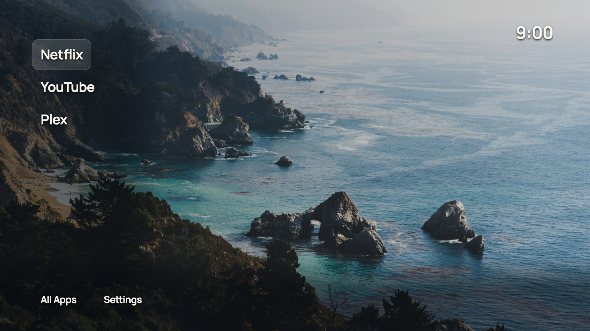
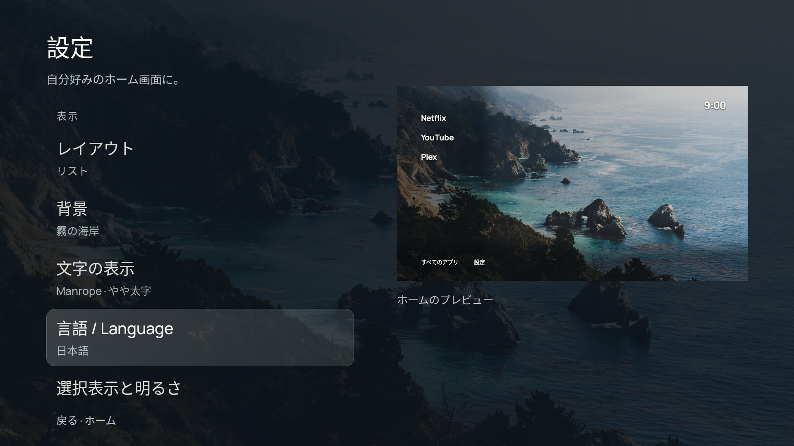

# CleanFrame Sharp

English · [日本語](README.ja.md)

A minimalist launcher developed for **Sharp AQUOS TVs running Android TV**: your apps, a photograph and the time. An unofficial Android adaptation inspired by [Nathan Clark’s CleanFrame](https://github.com/nthnclrk/CleanFrame).

**Developed for the Sharp AQUOS 4T-C45BL1 (AQUOS-TVJ19), running Android TV 10 / API 29. Other TV models and firmware are unverified.**

**This Android implementation was 100% AI-coded using ChatGPT Codex**, with the original CleanFrame GitHub project as its design/reference. Requirements, decisions and physical-TV testing were human directed. Original photographs, fonts and upstream design remain credited to their creators.

This is a separate Java Android app. It does not run CleanFrame’s Tizen HTML/CSS/JavaScript or the WebView runtime of [Depth118’s Android port](https://github.com/Depth118/cleanframe-androidtv), which was also consulted as a platform reference. It is not an official CleanFrame, Sharp or Google product.

## Features

- List and Dock layouts, remote navigation and a configurable Home app order.
- Fifteen credited wallpapers, gradients or your own photo.
- Font, size, weight, dimming and focus choices.
- English and Japanese interface; installed app names stay as supplied by Android.
- Optional Home-button service, with the original launcher kept available.
- Read-only system-package status; no ads, analytics or network permission.

## Preview

Automated renders with synthetic app fixtures; real icons come from installed apps.

## Install

Download the APK from Releases and follow the [step-by-step installation and recovery guide](INSTALL-AND-RECOVERY.md). No Android Studio is required.

Compatibility reported: **Sharp AQUOS 4T-C45BL1 (AQUOS-TVJ19), Android TV 10 / API 29**, through app version 1.0.2. Version 1.1.0 adds Japanese and the revised UI; its physical-TV confirmation is pending. An exact firmware build identifier was not recorded. Other models/firmware are unverified. Minimum Android version: 10.

## Optional service changes

[Optional system-service guide](OPTIONAL-SERVICES.md): the three packages reported disabled, their possible effects, and disable/enable commands. **These changes are not required for CleanFrame.**

## Privacy and credits

[Privacy](PRIVACY.md) · [Credits and third-party licences](THIRD_PARTY_NOTICES.md) · [MIT code licence](LICENSE) · [Japanese licence explanation](LICENSE.ja.md).

Original CleanFrame: copyright 2026 Nathan Clark, MIT. This Android project’s code/documentation: MIT. Fonts and photographs keep their own licences. No affiliation or endorsement is implied.

## Development and sharing

[Build](BUILDING.md) · [Contribute](CONTRIBUTING.md) · [Changes](CHANGELOG.md) · [Verification](VERIFICATION.md) · [GitHub upload guide](PUBLISHING.md).

Use the English/Japanese links at the top of each guide. Original third-party legal texts stay intact; Japanese explanations are provided separately. Remove device addresses, account details and identifiers before posting reports.
